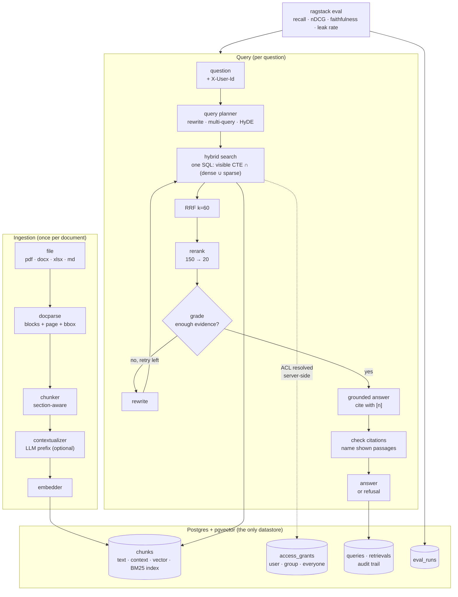

# ragstack

**A measured, permission-aware RAG reference implementation** for experimenting with retrieval
strategies under real document-level access control.

Every design knob is a config value and every config gets a number. One Postgres (pgvector +
ParadeDB `pg_search` for BM25), nothing else. Access control is enforced inside the retrieval SQL,
so a document a user cannot open is never retrieved, ranked or shown. Answers cite the chunks they
were built from, down to page and, where the parser provides it, bounding box (via
[docparse](https://github.com/Yassine-64/docparse)). Weak evidence refuses instead of guessing. On
six real 10-K filings ([FinanceBench](#financebench-real-company-10-ks-through-docparse-with-permissions))
the best config answers 66% correctly with zero cross-company leaks.

```
$ ragstack ask "What command rolls back a service deployment?" --user alice
Rollback is performed with `deployctl rollback <service> --to <previous-tag>`. [1]
  [1] deployment-runbook.md: 'Rollback is performed with `deployctl rollback <service> --to <previous-tag>`…'
  evidence=0.92 attempts=1 212 ms tokens=1611+30

$ ragstack ask "What command rolls back a service deployment?" --user bob      # bob ∉ engineering
I can't answer that from the documents I have access to.
(refused: evidence score 0.00 < 0.35)
```

The second answer is the point: bob never had the runbook in his candidate set. It was not
filtered out after retrieval, it was never retrieved, never ranked, never logged.

## What is in the box

| capability | how |
|---|---|
| hybrid retrieval | pgvector cosine top-N ∪ BM25 top-N (ParadeDB `pg_search`, English stemming + stopwords) in **one SQL statement**, fused with Reciprocal Rank Fusion (k=60) in the domain layer |
| ACL inside the query | `visible` CTE: tenant ∩ not-deleted ∩ grant to user, group or everyone. Deny by default. Groups resolved from the database, never from the request |
| reranking | cross-encoder top 150 → 20 (fastembed `ms-marco-MiniLM` on CPU, or Cohere) |
| contextual chunks | optional LLM-written situating sentence prepended before embedding and indexing (Anthropic's contextual retrieval) |
| query planning | optional rewrite, multi-query paraphrases, HyDE, each a flag |
| agentic loop | retrieve → grade evidence → rewrite → retry (bounded), then answer; explicit state machine, no framework |
| grounded generation | every `[n]` must name a passage the model was actually shown, else it is dropped; an answer left with no valid citation is refused, as is weak evidence or `NOT_IN_DOCS`. Whether the cited passage *supports* the sentence is measured by the eval judge (citation precision), not checked at runtime |
| audit | every question and every chunk shown to whom; `GET /v1/documents/{id}/exposures` |
| evals | recall@k, MRR, nDCG, faithfulness, citation precision, correctness, refusal correctness, **leak rate**, latency, cost; configs compared in one table; any leak fails CI |
| provenance | ingestion through docparse: each chunk keeps page + normalized bbox, so a citation points at a rectangle on a page |

## Architecture

```
src/ragstack/
├── domain/            models (Document, Chunk, AccessGrant, Principal, RetrievedChunk, Answer, Trace, EvalCase)
│                      ports (Embedder, Reranker, LLM, SearchIndex, repositories, DocumentParser)
│                      services (RRF fusion, citation reference checks)       ← pure, no I/O
├── application/       config (RetrievalConfig = the experiment), ingestion, retrieval, generation,
│                      agent loop, evaluation (metrics, judge, runner, report), use cases
├── infrastructure/    db (schema, pool, migrations), repositories (Postgres + the hybrid CTE),
│                      embeddings (fastembed, OpenAI, hashing), rerankers (fastembed, Cohere, lexical),
│                      llm (Anthropic, OpenAI, scripted), parsers (docparse, text), di container
└── interfaces/        FastAPI (documents, ask, search, health) · Typer CLI (ingest, ask, search, eval, user)
```

Dependency rule: arrows point inward. The domain imports nothing from the project. Every engine
is a port; the test doubles (`HashingEmbedder`, `LexicalReranker`, `ScriptedLLM`) implement the
same ports, so the whole pipeline including the agent loop runs in CI with no API key and no
model download. Design notes and the data model: [docs/ARCHITECTURE.md](docs/ARCHITECTURE.md).



## Quick start

```bash
make db           # Postgres (ParadeDB image: pgvector + pg_search) on :5433
uv sync --all-extras
cp .env.example .env            # defaults: fastembed embeddings + reranker, no LLM key → scripted LLM
make seed         # 4 users in 3 groups, 6 documents with ACLs (evals/corpus)
uv run ragstack ask "Who approves an expense of 20,000 EUR?" --user bob
uv run ragstack ask "Who approves an expense of 20,000 EUR?" --user alice     # refused: finance-only
make eval         # every config in evals/configs over evals/golden → comparison table
```

Set `RAGSTACK_ANTHROPIC_API_KEY` (or OpenAI) for real answers; the scripted LLM is a test double
that answers from lexical overlap so the control flow stays testable offline.

HTTP: `ragstack serve` → `POST /v1/documents` (multipart + `users`/`groups`/`everyone`),
`POST /v1/ask`, `GET /v1/search?q=`, `GET /v1/documents/{id}/exposures`. Identity arrives as
`X-User-Id` / `X-Tenant-Id` from whatever sits in front (gateway, SSO); groups never do.

## Evaluation

Golden set: [`evals/golden/handbook.jsonl`](evals/golden/handbook.jsonl), 15 cases over the demo
corpus: 11 answerable questions with expected answers and relevant documents, 3 ACL cases where
the asking user must be refused and the document must never appear, 1 out-of-domain question.

`ragstack eval` runs each config and prints (generation `claude-sonnet-5-5`, judge
`claude-opus-5-5`, embeddings `bge-small-en-v1.5`, BM25 via pg_search, laptop CPU):

| config | recall@10 | faithfulness | citation precision | correctness | refusal correct | leak rate | p50 ms | $/query |
|---|---|---|---|---|---|---|---|---|
| dense-only | 1.000 | 1.000 | 1.000 | 0.989 | 1.000 | **0.000** | 3035 | $0.0054 |
| bm25-only | 1.000 | 1.000 | 1.000 | 0.989 | 1.000 | **0.000** | 2949 | $0.0033 |
| hybrid-rrf | 1.000 | 1.000 | 1.000 | 0.986 | 1.000 | **0.000** | 2879 | $0.0054 |
| hybrid-rerank | 1.000 | 1.000 | 1.000 | 0.980 | 1.000 | **0.000** | 3347 | $0.0055 |
| hybrid-rerank-agentic | 1.000 | 1.000 | 1.000 | 1.000 | 1.000 | **0.000** | 5364 | $0.0089 |

Read it honestly: six short documents saturate retrieval, so every config finds the right chunk
and the generation columns only say that Claude, given the right passage, answers from it and
cites it. What this table does prove is the safety property (every ACL case refused, zero leaks,
enforced by CI) and that the harness runs end to end with a real model and a real judge. The
retrieval columns separate on the two harder corpora below. Tables are generated from
`evals/runs*/latest.md`, never typed by hand.

Offline (CI): the hashing embedder and the scripted LLM run the same 15 cases with zero keys;
that run is the leak gate, not a quality claim.

### BEIR SciFact: where the configs separate

`make beir` downloads [SciFact](https://github.com/beir-cellar/beir) (5,183 abstracts, 300 test
claims with expert relevance labels), ingests it, and runs the configs. Retrieval only:

| config | recall@10 | MRR | nDCG@10 | p50 ms |
|---|---|---|---|---|
| dense-only (bge-small) | 0.835 | 0.669 | 0.706 | 50 |
| bm25-only (pg_search) | 0.799 | 0.638 | 0.672 | 37 |
| **hybrid-rrf** | 0.828 | **0.683** | **0.714** | 206 |

Both single retrievers land where published numbers say they should: BM25 0.665 in the
[BEIR paper](https://arxiv.org/abs/2104.08663), bge-small-en-v1.5 0.713 in
[this BEIR comparison](https://arxiv.org/abs/2510.14880). Fusion adds about one point of nDCG
and 1.4 of MRR.

Two things this benchmark caught that the demo corpus could not:

- **Sparse search was silently empty.** The first version used Postgres `websearch_to_tsquery`,
  which ANDs every word, so a 15-word claim matched no abstract and "hybrid" equalled dense to
  three decimals. ORing the terms fixed recall but `ts_rank_cd` has no IDF, and hybrid dropped
  to 0.581. Real BM25 (ParadeDB `pg_search`) is what made fusion pay. A regression test pins it.
- **The reranker hurts here.** On a 20-claim probe, hybrid scores 0.804 nDCG and hybrid +
  `ms-marco-MiniLM-L-6` scores 0.732, at about 5 s per query on a laptop CPU. A cross-encoder
  trained on web search does not transfer to scientific claims. Reranking stays a measured
  option, off for this kind of corpus, and a domain reranker is an open item below.

### FinanceBench: real company 10-Ks, through docparse, with permissions

`make financebench` downloads six annual reports from
[FinanceBench](https://github.com/patronus-ai/financebench) (AMD, American Express, Boeing,
PepsiCo, Amcor, 3M: 1,482 pages, 5,911 chunks after docparse), gives each filing to that
company's analyst group only, and asks the 33 FinanceBench questions about them. Seven more cases
ask the same questions as another company's analyst, who must be refused. Recall is scored at
**page** level against the pages FinanceBench cites as evidence. Generation `claude-sonnet-5-5`,
judge `claude-opus-5-5`:

| config | page recall@k | MRR | correct | refused | ACL refused | leak rate | p50 ms | $/query |
|---|---|---|---|---|---|---|---|---|
| dense-only (k=10) | 0.227 | 0.120 | 0.103 | 79% | 7/7 | **0.000** | 1942 | $0.009 |
| bm25-only (k=10) | 0.273 | 0.158 | 0.000 | 88% | 7/7 | **0.000** | 1983 | $0.010 |
| hybrid-rrf (k=10) | 0.212 | 0.101 | 0.113 | 73% | 7/7 | **0.000** | 2035 | $0.013 |
| hybrid-rerank (k=10) | 0.364 | 0.194 | 0.191 | 64% | 7/7 | **0.000** | 6956 | $0.013 |
| hybrid, k=30 | 0.652 | 0.232 | 0.529 | 27% | 7/7 | **0.000** | 5026 | $0.060 |
| **claude-retrieval (k=20)** | **0.838** | **0.406** | **0.660** | 21% | 7/7 | **0.000** | 17589 | $0.102¹ |

¹ Excludes the Haiku reranking tokens (about 10k per retrieval attempt), which this column does not
yet count. `claude-retrieval` = Haiku listwise rerank of 60 candidates, query rewrite, two
paraphrases, HyDE, neighbouring chunks, up to two retries.

What it says:

- **Permissions hold on real filings.** Every cross-company question was refused and no filing
  ever reached the wrong analyst, in every config.
- **Claude inside retrieval is what moves it.** An LLM reranker that knows "purchases of property
  and equipment" is capital expenditure finds the right page 84% of the time and lifts correct
  answers to 66%, against 53% for simply widening the window. It costs 3.5x the latency of the
  k=30 config. Which of its five parts earns that is not measured yet: the next step is an
  ablation that switches each one off, and whatever does not pay for its latency gets cut.
- **Ten chunks is too few for a 10-K.** With ten chunks the grader correctly finds the needed
  table missing and the system refuses rather than invent a number. Thirty chunks lifts the
  right page into the window 65% of the time and correct answers to 53%. For scale, the
  FinanceBench paper reports 19% correct and 68% refused for GPT-4 Turbo over a shared index
  ([Islam et al., 2023](https://arxiv.org/abs/2311.11944)). The comparison is indicative only:
  that run used the full 150-question sample over many more filings; this one uses 33 over six.
- **Refusal beats hallucination.** Most wrong rows are refusals, not invented figures.
- **It found a real ingestion bug first.** The first 10-K crashed docparse: SEC filings render
  checkboxes as NUL characters, which collided with an internal marker. Fixed with a regression
  test in docparse.

Open: the faithfulness judge returned no parseable score on these long-evidence cases, so that
column is left out here rather than guessed.

## Status

- [x] hybrid search with ACL in the statement, RRF, reranking, sibling expansion
- [x] contextual chunks, query rewrite / multi-query / HyDE, agentic grade-rewrite-retry
- [x] grounded answers, citation references checked against shown evidence, refusal, audit trail
- [x] eval harness with leak gate in CI; 17 tests against real pgvector
- [x] BEIR adapter (`make beir`), SciFact table above; real BM25 via ParadeDB `pg_search`
- [ ] reranker that helps on SciFact (bge-reranker on a GPU, or Cohere), full 300-claim run
- [x] FinanceBench: six real 10-Ks via docparse, page-level recall, cross-company ACL cases
- [x] `claude-retrieval` (LLM rerank + HyDE + siblings) on FinanceBench: 66% correct, 0 leaks
- [ ] ablation of `claude-retrieval`: drop each part, keep only what pays for its latency
- [ ] scale benchmark: millions of synthetic chunks, many tenants, ACL selectivity vs HNSW plans
- [ ] judge calibration: 50 human-labelled cases, Cohen's κ against the LLM judge
- [ ] knowledge-graph retrieval mode (LightRAG-style local/global) behind the same `SearchIndex` port
- [ ] streaming answers, Redis cache for repeated questions

## Development

```bash
make check        # ruff + mypy --strict + pytest (integration tests use testcontainers or RAGSTACK_TEST_DATABASE_URL)
```

MIT.
