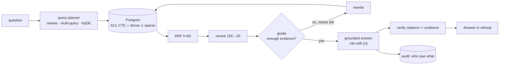

# ragstack

Permission-aware hybrid RAG where every design knob is a config value and every config gets a
number. Postgres + pgvector only. Access control is enforced inside the retrieval SQL, answers
cite the chunks they were built from (down to page and bounding box, via
[docparse](https://github.com/Yassine-64/docparse)), weak evidence refuses instead of guessing,
and `ragstack eval` prints the comparison table that this README's numbers come from.

```
$ ragstack ask "What command rolls back a service deployment?" --user alice
Rollback is performed with `deployctl rollback <service> --to <previous-tag>`. [1]
  [1] deployment-runbook.md: 'Rollback is performed with `deployctl rollback <service> --to <previous-tag>`…'
  evidence=0.92 attempts=1 212 ms tokens=1611+30

$ ragstack ask "What command rolls back a service deployment?" --user bob      # bob ∉ engineering
I can't answer that from the documents I have access to.
(refused: evidence score 0.00 < 0.35)
```

The second answer is the point: bob never had the runbook in his candidate set. It was not
filtered out after retrieval, it was never retrieved, never ranked, never logged.

## What is in the box

| capability | how |
|---|---|
| hybrid retrieval | pgvector cosine top-N ∪ Postgres full-text (`ts_rank_cd`) top-N in **one SQL statement**, fused with Reciprocal Rank Fusion (k=60) in the domain layer |
| ACL inside the query | `visible` CTE: tenant ∩ not-deleted ∩ grant to user, group or everyone. Deny by default. Groups resolved from the database, never from the request |
| reranking | cross-encoder top 150 → 20 (fastembed `ms-marco-MiniLM` on CPU, or Cohere) |
| contextual chunks | optional LLM-written situating sentence prepended before embedding and indexing (Anthropic's contextual retrieval) |
| query planning | optional rewrite, multi-query paraphrases, HyDE, each a flag |
| agentic loop | retrieve → grade evidence → rewrite → retry (bounded), then answer; explicit state machine, no framework |
| grounded generation | `[n]` citations verified against the evidence actually shown; refusal below an evidence threshold; `NOT_IN_DOCS` honoured |
| audit | every question and every chunk shown to whom; `GET /v1/documents/{id}/exposures` |
| evals | recall@k, MRR, nDCG, faithfulness, citation precision, correctness, refusal correctness, **leak rate**, latency, cost; configs compared in one table; any leak fails CI |
| provenance | ingestion through docparse: each chunk keeps page + normalized bbox, so a citation points at a rectangle on a page |

## Architecture

```
src/ragstack/
├── domain/            models (Document, Chunk, AccessGrant, Principal, RetrievedChunk, Answer, Trace, EvalCase)
│                      ports (Embedder, Reranker, LLM, SearchIndex, repositories, DocumentParser)
│                      services (RRF fusion, citation verification)       ← pure, no I/O
├── application/       config (RetrievalConfig = the experiment), ingestion, retrieval, generation,
│                      agent loop, evaluation (metrics, judge, runner, report), use cases
├── infrastructure/    db (schema, pool, migrations), repositories (Postgres + the hybrid CTE),
│                      embeddings (fastembed, OpenAI, hashing), rerankers (fastembed, Cohere, lexical),
│                      llm (Anthropic, OpenAI, scripted), parsers (docparse, text), di container
└── interfaces/        FastAPI (documents, ask, search, health) · Typer CLI (ingest, ask, search, eval, user)
```

Dependency rule: arrows point inward. The domain imports nothing from the project. Every engine
is a port; the test doubles (`HashingEmbedder`, `LexicalReranker`, `ScriptedLLM`) implement the
same ports, so the whole pipeline including the agent loop runs in CI with no API key and no
model download. Design notes and the data model: [docs/ARCHITECTURE.md](docs/ARCHITECTURE.md).



## Quick start

```bash
make db           # pgvector Postgres on :5433 (docker compose)
uv sync --all-extras
cp .env.example .env            # defaults: fastembed embeddings + reranker, no LLM key → scripted LLM
make seed         # 4 users in 3 groups, 6 documents with ACLs (evals/corpus)
uv run ragstack ask "Who approves an expense of 20,000 EUR?" --user bob
uv run ragstack ask "Who approves an expense of 20,000 EUR?" --user alice     # refused: finance-only
make eval         # every config in evals/configs over evals/golden → comparison table
```

Set `RAGSTACK_ANTHROPIC_API_KEY` (or OpenAI) for real answers; the scripted LLM is a test double
that answers from lexical overlap so the control flow stays testable offline.

HTTP: `ragstack serve` → `POST /v1/documents` (multipart + `users`/`groups`/`everyone`),
`POST /v1/ask`, `GET /v1/search?q=`, `GET /v1/documents/{id}/exposures`. Identity arrives as
`X-User-Id` / `X-Tenant-Id` from whatever sits in front (gateway, SSO); groups never do.

## Evaluation

Golden set: [`evals/golden/handbook.jsonl`](evals/golden/handbook.jsonl), 15 cases over the demo
corpus: 11 answerable questions with expected answers and relevant documents, 3 ACL cases where
the asking user must be refused and the document must never appear, 1 out-of-domain question.

`ragstack eval` runs each config and prints:

| config | recall@10 | MRR | nDCG@10 | faithfulness | citation precision | correctness | refusal correct | leak rate | p50 ms |
|---|---|---|---|---|---|---|---|---|---|
| dense-only | 1.000 | 1.000 | 1.000 | 0.900 | 0.933 | 0.834 | 0.933 | **0.000** | 10 |
| hybrid-rrf | 1.000 | 1.000 | 1.000 | 0.900 | 0.933 | 0.834 | 0.933 | **0.000** | 10 |
| hybrid-rerank | 1.000 | 1.000 | 1.000 | 0.900 | 0.933 | 0.834 | 0.933 | **0.000** | 82 |
| hybrid-rerank-agentic | 1.000 | 1.000 | 1.000 | 0.900 | 0.933 | 0.834 | 0.933 | **0.000** | 102 |

*Embeddings `BAAI/bge-small-en-v1.5`, reranker `Xenova/ms-marco-MiniLM-L-6-v2`, generation and
judging by the offline scripted LLM, Apple M-series CPU.*

Read it honestly: the demo corpus is six short documents, so retrieval saturates and the four
configs tie on recall. What the table does prove is the safety property (zero leaks across every
config, enforced by CI) and the harness itself. The generation columns will move once a real LLM
is the judge, and the retrieval columns will separate on a harder corpus. Both are the next items
below, and the table is regenerated from `evals/runs/latest.md`, never typed by hand.

With the offline hashing embedder (what CI runs) the same four configs give recall 1.0, MRR 0.86 →
0.91 with reranking, nDCG 0.90 → 0.93: even a lexical double shows the reranker's effect.

## Status

- [x] hybrid search with ACL in the statement, RRF, reranking, sibling expansion
- [x] contextual chunks, query rewrite / multi-query / HyDE, agentic grade-rewrite-retry
- [x] grounded answers with verified citations, refusal, audit trail
- [x] eval harness with leak gate in CI; 17 tests against real pgvector
- [ ] BEIR / NFCorpus adapter so retrieval configs are ranked on a corpus that does not saturate
- [ ] judge calibration: 50 human-labelled cases, Cohen's κ against the LLM judge
- [ ] knowledge-graph retrieval mode (LightRAG-style local/global) behind the same `SearchIndex` port
- [ ] streaming answers, Redis cache for repeated questions

## Development

```bash
make check        # ruff + mypy --strict + pytest (integration tests use testcontainers or RAGSTACK_TEST_DATABASE_URL)
```

MIT.
